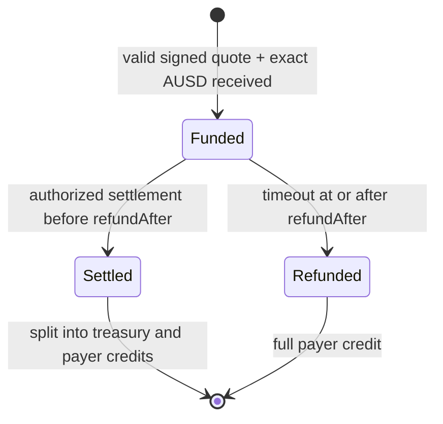

# AUSD execution escrow specification

Research date: October 11, 2026. **Design only; not implemented, deployed or audited.** Prerequisite: [sandbox treasury and execution architecture](PAYMENTS_ARCHITECTURE.md).

## What this contract buys us

Hold a user's test AUSD pack budget until ImPacks reports the completed execution cost. Split that budget into a treasury credit and an unspent payer credit. If no valid settlement is recorded before the deadline, permit anyone to make the whole deposit refundable to its original payer.

The contract does not call Gemini, buy predictions, validate Gemini fills, bridge AUSD to Gemini, or collateralize future market winnings. ImPacks remains a trusted execution/settlement authority. An execution hash makes the reported result identifiable; it is not a cryptographic proof that the exchange executed it. A dishonest authorized settler can claim a permitted charge without an actual trade. Timeout refunds protect only deposits that have not already been settled.

Gemini operates off-chain and its sandbox cash is separate from AUSD. This is an execution-payment escrow with a trusted attestation, not trustless delivery-versus-payment. [Gemini sandbox](https://developer.gemini.com/get-started/sandbox)

## Deployment scope

Proposed first contract: `ImPacksEscrow`, non-upgradeable, Ethereum Sepolia only, one immutable AUSD token. Pin token `0xa9012a055bd4e0eDfF8Ce09f960291C09D5322dC`, chain 11155111, six decimals. Verify bytecode, deployment/proxy implementation, decimals and transfer behavior before deployment. [Agora deployments](https://docs.agora.finance/developer/contract-deployments)

Use a pinned compatible Solidity/compiler and OpenZeppelin 5.x release, Foundry for tests, and a TypeScript chain adapter. Use SafeERC20 transfers, ReentrancyGuard, EIP-712 quote hashing and explicit access control. Review inherited behavior against this specification, especially pause scope. [SafeERC20](https://docs.openzeppelin.com/contracts/5.x/api/token/erc20), [utilities](https://docs.openzeppelin.com/contracts/5.x/api/utils), [cryptography](https://docs.openzeppelin.com/contracts/5.x/api/utils/cryptography), [access control](https://docs.openzeppelin.com/contracts/5.x/access-control)

No delegatecall, arbitrary external-call executor, operator cancellation of user credits, upgrade key, deadline extension, or AUSD sweep function. Testnet simplicity is intentional. Unsolicited direct AUSD transfers are not credited deposits and should be discouraged by the UI; surplus recovery can wait for a separately reviewed version.

## Signed quote

Use an EIP-712 quote signed by an authorized quote signer. Its domain includes name, version, chain ID and verifying contract. A quote is valid for one contract/network only. Proposed fields:

```solidity
// Interface sketch only, not a deployable implementation.
struct Quote {
    bytes32 purchaseId;
    address payer;
    address treasury;
    address settler;
    uint256 amount;          // AUSD atomic units; 15 AUSD = 15_000_000
    bytes32 drawCommitment;
    bytes32 policyHash;
    uint64 fundingDeadline;
    uint64 refundAfter;
}
```

`purchaseId` is globally unique for this escrow. `policyHash` covers versioned terms: theme, three-card selection policy, card budgets/price and fee caps, nominal sandbox-USD mapping, partial-fill handling, and no AUSD redemption of paper winnings. `drawCommitment` covers a canonical versioned encoding of the ordered selections, immutable execution bounds and a secret 32-byte salt. Publish the canonical encoding and reveal data with the result. Hash comparison establishes consistency only, not fairness or real execution.

The server binds this purchase to the authenticated user. On-chain identity is the payer address, not a Privy DID. Keep identity data and Gemini credentials/order details off-chain; use opaque hashes in public events. Public payer/amount/timing remain visible.

Snapshot treasury and settler in each funded deposit. Verify both against approved active addresses at funding. Later configuration changes affect new quotes only; admin cannot redirect an existing deposit. Quote signer revocation blocks new funding; it does not rewrite funded obligations.

Require `now < fundingDeadline < refundAfter`, a minimum execution window between deadlines, a maximum quote lifetime, a maximum escrow duration, and a maximum per-deposit amount. Constructor policy bounds cannot be loosened for an existing deposit. Choose actual timing after measuring RPC finality and order-recovery latency; a short animation duration is not an execution/refund deadline.

## State and interface



Store `status`, quote hash, payer, treasury, settler, amount, deadlines, commitments and final execution digest/charge. Maintain aggregate funded liability and `claimable[address]` credits separately. A terminal state does not mean tokens have already been withdrawn.

```solidity
function fund(Quote calldata quote, bytes calldata quoteSignature) external;
function settle(bytes32 purchaseId, uint256 charged, bytes32 executionDigest) external;
function refundExpired(bytes32 purchaseId) external;
function withdrawFor(address beneficiary) external;
function getDeposit(bytes32 purchaseId) external view returns (Deposit memory);
```

### fund

Require the caller to equal `quote.payer` for the approve/transferFrom version. Validate signature, signer role, approved treasury/settler, policy bounds, nonzero addresses/amount, funding deadline and unused purchase ID. The payer explicitly approves the exact amount, then calls `fund`.

Guard reentrancy, reserve the ID/state before the external transfer, and require the contract's received balance delta to equal the quoted amount. SafeERC20 success alone is insufficient for a fee-on-transfer token. If transfer or amount verification fails, revert the whole transaction. Record `Funded` and emit the quote hash and immutable terms. A bare ERC-20 transfer to escrow must never create a funded purchase.

Frontend: verify the server quote against displayed chain, token, amount, payer, escrow and deadlines before asking for approval. A rejected approval or rejected funding transaction creates no deposit. An approval alone is not a payment. Exact approval limits exposure; provide allowance revocation guidance on abandoned checkout if useful.

### settle

Only the deposit's snapshotted settler, still globally authorized, may call. Require `Funded`, `now < refundAfter`, and `charged <= amount`. Change to `Settled`, decrement funded liability by the full amount, credit treasury with `charged`, and credit payer with `amount - charged`. Emit the split and execution digest. No external token transfer occurs here.

Settling zero refunds the whole budget early when all orders are proven unfilled. Settlement is once per pack after all card orders are terminal and fees are known; no partial on-chain captures in v1. While one order is unknown, the whole deposit remains funded. The backend validates per-card policy caps; the contract enforces the total amount, identities and deadline, not the contents of an opaque policy hash.

### refundExpired

Anyone may call for a `Funded` deposit when `now >= refundAfter`. Move it to `Refunded`, move the entire amount from funded liability to payer credit, and emit an event. This needs no signature or live ImPacks server. It does not run automatically as time passes: the user or a keeper must submit a transaction and pay gas.

Exactly at the boundary only refund is valid. A user cannot use this method on a settled deposit. Both settle and refund are terminal, so one deposit cannot pay both paths.

### withdrawFor

Anyone may trigger withdrawal of a beneficiary's accumulated credit, but the transfer destination must be that beneficiary. Zero the credit and reduce total credits before `safeTransfer`, under a reentrancy guard. A revert restores credit. Emit the withdrawal. There is no caller-supplied alternate destination, and a relayer cannot take the user's funds.

Separate withdrawal means a blocked treasury transfer cannot prevent a payer's refund credit from being created. Token restrictions can still prevent actual withdrawal. Agora documents token freezing and upgradeability; our non-upgradeable escrow cannot eliminate those token-level dependencies. [Agora security model](https://docs.agora.finance/developer/security-and-compliance)

## Roles and emergency behavior

| Authority | Powers | Limits |
| --- | --- | --- |
| Admin | Approve/revoke quote signers, settlers and treasuries for new funding; manage guardian | Cannot replace existing deposit addresses or extend deadlines; no token sweep |
| Quote signer | Authorize capped, expiring funding quotes | Cannot debit a wallet; payer funds explicitly |
| Settler | Split its deposits before timeout | Total charge bounded by deposit; cannot settle another settler's deposit |
| Guardian | Pause new funding and settlement; revoke compromised execution authority | Cannot block timeout refunds or withdrawals |
| Keeper / any caller | Trigger expired refunds and fixed-beneficiary withdrawals | Cannot redirect funds |

Separate quote/settlement signer credentials from the treasury withdrawal controller. Use a protected admin (multisig when practical), server-only operational keys, and a gas-funded keeper. A compromised settler is still capable of false attestations before revocation; minimizing its funded exposure and watching settlements are operational controls, not proof of correctness.

Use separate pause controls for new funding and settlement. During an integration outage pause new funding, while known valid settlements may complete. During suspected signer compromise also pause settlement. Refund and withdrawal methods remain usable. If an old settler is revoked, its unresolved deposits expire to refunds; admin cannot appoint a replacement for those deposits. The operator bears any already-executed exchange exposure.

## Worker orchestration and the non-atomic boundary

1. Persist the quote/draw and execution intent before publishing the signed quote.
2. Observe the verified `Funded` event at the chosen finality threshold; verify its contents against the database. Reserve sufficient separate Gemini capacity before ordering.
3. Execute/reconcile using the same durable order and fill machinery as the treasury design. Do not issue a trade if too little time remains to reconcile and submit settlement.
4. Build a canonical execution receipt: purchase and quote hashes, exact per-card fills/notional/fees, total charge, remainder, and provider identifiers. Store it; hash it into `executionDigest`.
5. Persist settlement transaction intent and nonce, submit, and track canonical chain state. “Submitted” does not mean settled. Detect timeout/refund competition.
6. Finalize user position allocation after the escrow settlement is confirmed under the configured chain policy. Until then show execution as provisional. Index settlement/refund events exactly once into the ledger.
7. Withdraw treasury proceeds and payer remainder independently. Keep a minimal user recovery page plus ABI/address so users can invoke timeout refunds without the regular API.

**Unavoidable race:** Gemini may accept a trade while its reply is lost. The escrow deadline can expire before the backend proves the fill. A timeout refund and a late Gemini fill cannot be atomically coordinated. Stop sending new orders ahead of the deadline, use IOC, reconcile aggressively, and reserve operator capacity for this scenario—but these only reduce risk.

If refund wins, return the full AUSD and assign any orphaned Gemini position to the operator exception inventory. Do not re-debit the user or also give away that position as a funded card. The operator may later manage that exposure through a separately authorized process. If an on-chain settlement is orphaned after provisional allocation, freeze/reconcile that purchase under the same policy. Never claim that this escrow removes execution risk.

## Gasless funding: later extension

Start with exact `approve` plus `fund`, then add `fundWithAuthorization` after verifying the deployed AUSD ABI and wallet signing compatibility. Agora advertises ERC-2612, ERC-3009 and ERC-1271 support; this does not establish the exact deployed function overloads or signing domain. [Agora contract features](https://docs.agora.finance/contract-overview), [advanced features](https://docs.agora.finance/developer/advanced-erc-features)

For ERC-3009, prefer a wrapper calling the token's `receiveWithAuthorization` so receipt and escrow accounting occur atomically. The standard restricts the receiving call to the payee, mitigating a front-run that consumes a transfer authorization before the wrapper credits the purchase. A generic `transferWithAuthorization` followed later by `fund` is not an equivalent flow. [ERC-3009](https://eips.ethereum.org/EIPS/eip-3009)

Require authorization `from == quote.payer`, `to == escrow`, exact value, bounded validity, and a nonce bound to the unique domain-separated quote digest. The payer signs the token authorization; the server signs the escrow quote. The wrapper verifies both and marks the purchase funded within one transaction. A relayer may submit but cannot alter destination/amount/purchase. Failed funding must revert token authorization consumption as well.

Before coding this extension, inspect the actual token domain separator/name/version, authorization-state semantics, nonce shape, receiver method/overloads and contract-wallet behavior. Test the actual Privy wallet type. Retain approve/fund as fallback. Gasless means someone else funds gas; it does not eliminate gas. Treat x402 as a separate transport/facilitator integration with explicit network/token/custom-escrow support testing.

## Invariants and verification

For every funded deposit, exactly one terminal disposition is possible. For each settled deposit, `charged + payerRemainder == originalAmount`. Globally:

```text
fundedLiability = sum(amount of deposits still Funded)
creditLiability = sum(claimable beneficiaries)
AUSD.balanceOf(escrow) >= fundedLiability + creditLiability
```

The inequality permits unsolicited donations. Funding increases balance and liability equally; settlement/refund only move liabilities; successful withdrawals reduce balance and credits equally. No admin function may break these rules.

Required Foundry unit/fuzz/invariant cases:

- Wrong signer, payer, chain/domain/contract, amount, treasury or settler; replayed purchase IDs; quote mutation; zero addresses; duration/cap overflow and boundary timestamps.
- Exact funding, reverted token transfer, unexpected received amount, direct donation, reentrant token/recipient, partial and zero charge, excessive charge, duplicate settle/refund and withdrawals.
- Settlement strictly before timeout; refund at/after timeout; competing transactions; revoked settler, signer rotation and changed default treasury preserve existing obligations.
- Funding/settlement pause never disables timeout refunds or withdrawal; token freeze/revert preserves credit.
- Stateful random action sequences prove conservation and terminal-state uniqueness; no route for a relayer/admin to redirect payer funds.
- Fork/integration checks against the actual Ethereum Sepolia AUSD deployment, then funded wallet smoke tests. Mock ERC-20 tests alone do not validate token-specific behavior.
- ERC-3009 extension: altered authorization, nonce replay, expired/not-yet-valid signature, front-running, wrong domain, receiver overload, smart-wallet signature support and relayer failure.

End-to-end failure tests must kill/restart the worker after funding, after exchange submission, after a fill, before settlement, after settlement broadcast and before withdrawal confirmation. Verify the resulting chain events, ledger and user lots, not merely HTTP responses.

## Implementation locations and release gate

Proposed additions: `contracts/escrow/` for Solidity, Foundry tests and deployment manifests; `apps/api/src/services/escrow.ts` plus chain/worker adapters; shared quote/status types in `packages/contracts`; funding/refund UX in `apps/web`. Do not mix Solidity contract source with the existing TypeScript DTO package just because both use the word contracts.

Implementation order: finish the shared sandbox prerequisites → implement contract/tests → adapter and event indexer → local full-flow recovery → actual-token testnet smoke → independent security review before real funds. Record chain/address, compiler/optimizer settings, source commit, ABI, token implementation observed, role addresses, policy bounds and transaction evidence in a deployment manifest. Pin frontend/backend to that manifest.

Do not migrate existing treasury deposits into escrow implicitly. Select `paymentMode=treasury` or `paymentMode=escrow` per immutable quote; reconcile each mode separately. Deploying escrow does not make prior custodial balances escrow-backed.

Escrow is ready for a hackathon demo only when funding, partial/zero settlement, timeout refund and withdrawal are verified on Ethereum Sepolia, crash recovery preserves one economic outcome, and the UI accurately distinguishes a funded deposit, an attested execution and a confirmed holding.
