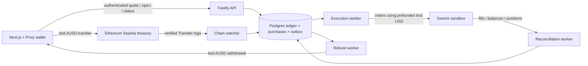

# Sandbox treasury and execution architecture

Research date: October 11, 2026. **Proposed implementation; no external payment, trade, or contract deployment was performed for this research.** Companion: [AUSD escrow specification](ESCROW_SPEC.md). This document specifies the next integration; it does not describe functionality already shipped.

## Recommendation

Build the treasury-and-ledger sandbox first. Users pay testnet AUSD into an ImPacks wallet; a durable ledger reserves their pack budget; a worker buys the randomly selected positions using ImPacks' separately funded Gemini sandbox account. Add escrow only after payment attribution, execution recovery, and refunds work. Both approaches need the same database, workers, account reconciliation, and user allocation records.

This is payment coordination, not a bridge. Gemini documents a starting sandbox balance of $100,000 test USD and supports only testnet BTC deposits/withdrawals. Testnet AUSD cannot fund or redeem that USD. [Gemini sandbox](https://developer.gemini.com/get-started/sandbox)

| Question | Treasury + ledger | Execution escrow |
| --- | --- | --- |
| Who holds AUSD before execution? | ImPacks treasury | Contract |
| Who owns the Gemini account? | ImPacks sandbox account holder | Same |
| Where are users' card allocations recorded? | ImPacks database | Same |
| Who decides whether Gemini executed correctly? | ImPacks worker/reconciliation | ImPacks settlement authority |
| Recovery if ImPacks disappears | No autonomous AUSD refund | Expired, unsettled deposits can become withdrawable |
| Does it back future market winnings? | Only if separately funded and specified | No; proposed escrow covers purchase execution only |
| Build order | First | After the shared backend works |

## Product policy for the first integration

These are recommended defaults, to implement together with the new shared API types:

- Ethereum Sepolia test AUSD only; Gemini sandbox only. Clearly show both environment labels.
- Pack budget remains 15 test AUSD, three allocations of 5, zero ImPacks fee. Each allocation includes any Gemini execution fees. Charge only confirmed executed notional plus fees under the disclosed nominal mapping of one test USD budget unit to one test AUSD unit.
- Unspent amounts return to the user's test AUSD available balance and can be withdrawn. A completely unfilled pack returns its full budget. Gas is separate; the treasury pays refund transaction gas in the initial demo.
- Market and side are randomly selected within the eligible theme. Draw once, three distinct instruments, uniform selection without replacement, 50/50 YES/NO. A later failure does not trigger a fresh draw.
- Use bounded limit IOC orders initially. A pack can have fewer than three filled cards. Display failed/unfilled cards and refund amounts honestly; do not animate them as owned positions.
- Portfolio cards represent internal allocations in a pooled sandbox account. They are not individually held Gemini accounts or on-chain position tokens.
- Record market settlements and paper winnings in a separate `GEMINI_SANDBOX_USD` ledger. **Do not make those winnings withdrawable as AUSD in v1.** Refunds of unused AUSD are withdrawable. Adding AUSD prize redemption is a separate treasury-backed feature.
- No automatic reinvestment or additional wallet debits beyond the accepted pack budget.

Example: the user deposits 15 test AUSD. Confirmed orders use 13.40 sandbox USD and fees use 0.10. Capture 13.50 test AUSD from the reserved budget, return 1.50 to available, and allocate only confirmed fill quantities. The treasury still holds the AUSD; Gemini independently debits its test USD. The capture is an internal funding allocation, not evidence of a currency conversion or platform profit.

## Architecture

Keep Next.js on its current host. Run the durable API and worker as separate processes backed by Postgres; a database outbox/job table is sufficient initially. An execution must survive browser closure, API restart, duplicate requests, and worker replacement. Never run payment or exchange side effects from the current Vercel embedded demo's process-local Maps.

### Current repository gap

The repo has a Next.js UI, server-side Privy access-token verification, configured embedded wallets, and a read-only AUSD balance endpoint. Wallet creation and the complete authenticated flow still need end-to-end evidence. The balance endpoint does not authenticate ownership of its address. Packs, receipts, orders, and sessions are process-local; providers simulate payments/trading, and `APP_MODE` intentionally rejects non-demo operation.

`PaymentProvider.confirm` and `OrderProvider.buy` are starting points, not sufficient recovery interfaces. Add payment observation/finality, order lookup/history, fill ingestion, cancellation, balances, settlement reconciliation, and withdrawal lookup. Shared DTOs must expose durable states and exact amounts. No application code is changed by this architecture.

## Prerequisites and evidence

| Dependency | Required setup | Evidence before enabling execution |
| --- | --- | --- |
| Privy | Existing app; server-verified identity and payer binding | Real login; paying address belongs to verified user; cross-user receipt claim rejected |
| Postgres | Migrations, constraints, transaction isolation, backups | Restart and concurrent-open tests preserve one reservation/draw/order intent |
| Ethereum Sepolia RPC | Chain 11155111; dedicated RPC and archive/replay access sufficient for watcher | Chain ID, token code/decimals, successful transfer and reorg/replay recovery |
| Treasury | Dedicated testnet receiver and restricted refund signer; test ETH | Test AUSD received and refund confirmed; signer serialized by nonce |
| Test AUSD | `0xa9012a055bd4e0eDfF8Ce09f960291C09D5322dC`, six decimals | Check actual deployment before use; never substitute the mainnet address |
| Faucet | Test ETH and AUSD for test wallets | Faucet receipt plus wallet balance; no purchased funds needed |
| Gemini account | Dedicated sandbox account; account-scoped Trader key, time-based nonces | Terms/access verified, active symbols, balance, order, fill and recovery proven |
| Runtime | API, chain watcher, execution/refund/reconciliation jobs | Jobs continue without browser or web request; alerts for stale/unknown work |
| Product contract | Versioned budget, draw, fee, partial-fill and refund disclosure | User consent stored against the immutable quote |

Agora lists the [Ethereum Sepolia deployments](https://docs.agora.finance/developer/contract-deployments), [six-decimal API amounts](https://docs.agora.finance/api), and [testnet faucet procedure](https://docs.agora.finance/instant-settlement/guides/getting-testnet-tokens). Treat the faucet and token as separate contracts.

Proposed configuration: `DATABASE_URL`, `ETHEREUM_SEPOLIA_RPC_URL`, `AUSD_TOKEN_ADDRESS`, `TREASURY_ADDRESS`, `GEMINI_ENV=sandbox`, server-only Gemini credentials, and a signer-service reference. Store private keys only in server secret storage; none belongs in `NEXT_PUBLIC_*`. Enforce sandbox/testnet allowlists at startup, not just visual labels. Keep `APP_MODE=demo` until the new sandbox implementation and its acceptance checks exist.

### Identity and wallet binding

Authenticate each mutation using the verified Privy DID. Fetch/verify identity data server-side and require its user ID to match the authenticated subject; select a verified linked Ethereum wallet. Privy recommends identity-token user lookup for authenticated requests. Do not accept client-supplied linked-account JSON as proof. Persist the bound address and verification provenance; refresh it before sensitive changes. An external-wallet signature challenge is an alternative, with a single-use nonce, app domain, chain, expiry, and contract-wallet verification where applicable. [Privy user lookup](https://docs.privy.io/user-management/users/managing-users/querying-users), [access-token verification](https://docs.privy.io/authentication/user-authentication/access-tokens)

For v1, require one active user binding per payer wallet. Unlinking a wallet must not reassign old deposits or change a pending refund recipient. Pin the payer/return address at deposit acceptance. Wallet connection alone is insufficient: Privy's connect flow can connect without an authentication signature. [Privy wallet connection](https://docs.privy.io/wallets/connectors/usage/connect-or-create)

## Deposit, quote, execution, refund

1. **Create payment instructions.** The server returns chain, token, treasury, amount, and bound payer. Ordinary ERC-20 transfers contain no quote ID. Treat them as user deposits first; then reserve a pack from the credited balance. This avoids matching identical 15-AUSD transfers to quotes by amount or timestamp.
2. **Verify the chain event.** A client transaction hash is only a hint. Check successful receipt, chain, token-emitted `Transfer`, event sender, recipient, amount, block hash, and finality policy. The ERC-20 event's sender matters, not the outer transaction sender, which may be a relayer. Credit each `(chain, token, txHash, logIndex)` once in a transaction. Quarantine transfers from unbound wallets for recovery rather than assigning them to whoever submits the hash.
3. **Handle late/incorrect payments.** Credit a valid recognized deposit's actual amount, even after a quote expires; never silently spend it on a new quote. Insufficient deposits cannot open a pack. A new quote requires fresh consent. Wrong-token or wrong-network transfers do not count as AUSD funding.
4. **Quote and reserve.** Validate eligible liquidity on both outcomes before drawing. In one database transaction create the immutable quote, consent record, committed draw, AUSD reservation, sandbox capacity reservation, and execution job. With insufficient funds, return payment-required instructions; never submit an order. A user-approved top-up/open flow may automate this transition while the accepted quote remains valid.
5. **Draw once.** Store the selected instrument IDs, sides, per-card budgets/limits, market snapshot, algorithm version, and random salt before any order. Node cryptographic randomness is suitable for the initial server-owned draw. A salted commitment can expose later changes, but does not prove unbiased selection or prevent server grinding. Do not advertise it as provably fair.
6. **Submit from a durable intent.** Record one stable client order ID per card, acquire the purchase lease, recheck price/market status and budget, then submit. Expired/slipped/unavailable selections become unfilled; no reroll. Use exact decimal arithmetic and instrument increments.
7. **Reconcile before capture.** Ingest fills idempotently, query history after disconnects, confirm all orders terminal and fees known. A timeout means `unknown`, not failure. Never issue a replacement ID or release an uncertain order's reserved budget simply because HTTP timed out.
8. **Allocate and return remainder.** Commit fills, per-user position lots, captured budget, unspent available balance, and final opening status atomically. Charge no more than consented caps. Unexpected excess fees become an operator exception/loss, never another user debit.
9. **Withdraw remainder.** A user request atomically moves available balance into withdrawal-pending. Persist signed transaction bytes/hash and signer nonce before broadcasting, then track inclusion/finality. Rebroadcast the same transaction, or track a same-nonce replacement; do not create an independent payment after an ambiguous RPC response. Finalize the debit only on verified payment; a known terminal failure releases the reservation.

Base distinguishes latest/unsafe, safe, and finalized blocks. Recommended initial accounting release uses a configured `safe` policy if supported by the chosen RPC; show pending while waiting. A faster testnet confirmation-count policy is an explicit operator risk setting, not equivalent to finality. Store block hashes, rescan with overlap, and reverse orphaned credits using compensating journal entries. If an orphaned credit already funded a Gemini trade, stop the affected flow and assign the exposure to the operator; do not invent a successful payment. [Base derivation and finality](https://docs.base.org/base-chain/specs/protocol/consensus/derivation)

## Gemini adapter details

Use the official SDK's server transport, pinned to a tested version. REST sandbox base: `https://api.sandbox.gemini.com`; the sandbox guide lists `wss://ws.sandbox.gemini.com`. Prove the current prediction-specific SDK route by opening a sandbox stream; a successful spot connection is insufficient. Never fall back to production when sandbox is unavailable. [SDK](https://developer.gemini.com/tools), [sandbox](https://developer.gemini.com/get-started/sandbox)

Account-scoped WebSocket keys require time-based nonces and Trader permission for order placement; master/group keys are not accepted. Allocate monotonic nonces across worker reconnects for each key. Keep authenticated sockets on the backend. Check `/v1/prediction-markets/terms/status`; the account holder must review and accept applicable terms before trading. [Authentication](https://developer.gemini.com/prediction-markets/websocket/authentication)

| Need | Integration and decision |
| --- | --- |
| Discovery | `GET /v1/prediction-markets/events`; use actual `instrumentSymbol`, live status, category and close time; handle pagination/child events |
| Quotes | Subscribe to fresh prediction books; normalize YES/NO executable asks correctly, including quantities; never derive NO ask from YES ask alone |
| Precision | Read `quantityIncrement`, `quantityMinimum`, `priceIncrement`, `priceMinimum`, `quoteAssetPrecision`; validate, round quantity down, keep budget conservative |
| Submission | Prefer WebSocket `order.place` with stable `clientOrderId`; verify actual SDK schema and ID constraints with the sandbox |
| REST alternative | `POST /v1/prediction-markets/order`; documented request fields differ from WS. Verify client-ID support before using it for retry-safe submission |
| Recovery | Prediction active/history orders, positions, settled positions; persist pagination/checkpoints and reconcile after reconnect |

Sources: [market discovery](https://developer.gemini.com/prediction-markets-spec/markets), [trading specification](https://developer.gemini.com/prediction-markets-spec/trading), [WebSocket methods](https://developer.gemini.com/trading/websocket/playground).

An order acknowledgement is not a fill. For Gemini IOC, even a fully filled order can terminate as `CANCELED`. The execution-quantity field is incremental on fill messages and cumulative on cancel messages; do not sum both. Preserve trade/order IDs losslessly, including numeric IDs larger than JavaScript's safe integer range. Available cash and confirmed cash are different fields. Use streams for updates, REST for recovery. [Stream semantics](https://developer.gemini.com/trading/websocket/streams)

FOK can make one card all-or-none; it cannot make all three atomic. The REST batch operation also is not an atomic pack. Do not attempt compensating sells as an invisible rollback: that creates a second trade and possible loss. [Order and batch behavior](https://developer.gemini.com/prediction-markets-spec/trading)

**Fees:** the published schedule currently specifies taker rate 0.07 applied to `quantity × price × (1 − price)`, rounded upward to cents. Rates/promotions can change; verify applicability and sandbox behavior. Budget for actual fill-level rounding and reserve a conservative bound. Do not use a maker promotion to price IOC taker orders. A 5-unit card allocation is not a 5-unit notional order plus fees. [Prediction fees](https://www.gemini.com/fees/predictions)

**Pooled-account gate:** settled positions use signed YES/NO quantities. This is a reason to test opposite-side netting, cost basis, realized cash, and collateral behavior before multiple users share instruments. Keep immutable per-user lots from fills; an account-level net position cannot reconstruct them. Reconcile user claims against both account positions and cash reserved for offset claims. Do not treat released collateral as free operator money. If this cannot be proven during the hackathon, restrict eligible instruments to those with no other active/reserved user allocation, disclose that restriction, and disable packs when fewer than three qualify. Do not silently bias side selection to avoid netting. [Settled-position schema](https://developer.gemini.com/rest-api/prediction-markets/positions/get-settled-positions)

## Database and accounting

Use append-only, balanced postings within each asset namespace. Assets include `AUSD:11155111:<token>` and `GEMINI_SANDBOX_USD:<account>`. Never balance an AUSD debit against a sandbox USD credit. Store AUSD in integer micro-units (`15 AUSD = 15000000`); exchange amounts as validated decimal strings/scaled integers using the documented precision. No floating-point money and no blanket integer-cent price assumption.

| Records | Required keys / guarantees |
| --- | --- |
| users, wallet bindings, sessions | Stable Privy DID; verified wallet provenance and binding history |
| quotes, purchases, draw snapshots | Immutable policy/consent, prices/caps, payer; unique user/idempotency key; one opening per quote |
| payment intents, chain events | Unique chain/token/tx/log; original block hash; observed/safe/orphaned states |
| journal transactions, postings | Unique business-event ID; balanced per asset; immutable entries; compensating corrections |
| reservations | Locked user available balance and exchange capacity; no negative availability |
| order intents, fills, lots | Unique account/clientOrderId; unique provider fill identity; exact IDs; per-user allocation |
| withdrawals and chain transaction attempts | Immutable beneficiary/amount; nonce, hashes/replacements, finality state |
| outbox jobs, inbox events, checkpoints | Transactional enqueue; durable leases; retries/backoff; event deduplication |

Operational AUSD journal example (not a statutory financial-statement policy):

| Event | Debit | Credit | AUSD |
| --- | --- | --- | ---: |
| Deposit | Treasury asset | User available liability | 15.00 |
| Reserve | User available liability | User reserved liability | 15.00 |
| Capture | User reserved liability | Pack funding clearing | 13.50 |
| Return remainder | User reserved liability | User available liability | 1.50 |
| Request withdrawal | User available liability | Withdrawal payable | 1.50 |
| Confirm withdrawal | Withdrawal payable | Treasury asset | 1.50 |

`Pack funding clearing` tracks consumed demo budget; it is not automatically recognized revenue. Gemini cash, execution fees, positions and paper settlement entries are recorded separately. Per-card charges plus returned remainder must equal the original reserved pack amount. All postings and position allocations need a durable link to their source event.

Maintain `treasury AUSD >= available + reserved + withdrawal payable` with no double-counted categories. In-flight receipts do not create available funds. Separately reserve Gemini capacity under an account lock: exchange reported available cash already excludes acknowledged exchange holds; subtract only local commitments not yet reflected in that snapshot. Prove this accounting across acknowledgement races. Stop new packs when balances are stale, capacity is insufficient, or reconciliation disagrees.

If we later promise test-AUSD winnings, fund that promise explicitly. Reserve the maximum aggregate payout across feasible outcomes plus outstanding AUSD cash/refund liabilities; conservatively summing every card's maximum gross payout is sufficient but capital intensive. Sandbox USD cannot satisfy that reserve. Production fiat/AUSD redemption requires a new funding, custody and provider-eligibility design.

## Shared API and UI handoff

Proposed endpoints (not currently implemented):

- `POST /api/deposits` → immutable instructions for the bound wallet; `POST /api/deposits/:id/proof` → transaction hint; `GET /api/balances` → AUSD available/reserved/withdrawal-pending and separate paper USD.
- Extend quote/open DTOs with policy version, exact amounts, immutable draw commitment, per-card spend/fee caps, payment mode and durable purchase ID. Existing `Idempotency-Key` semantics persist in the database.
- `GET /api/purchases/:id` → payment, execution, allocation and refund states separately; ownership checked on every lookup.
- `POST /api/withdrawals` with idempotency key → withdraw available test AUSD to the pinned verified address; `GET /api/withdrawals/:id` → chain status.

Frontend states: needs funds, awaiting wallet, payment pending, funded, executing, reconciling, complete, partial, unfilled/refundable, withdrawal pending, withdrawn. A rejected signature causes no debit. A refresh resumes the purchase. An unknown order shows “Checking execution”; it does not offer a second purchase as recovery. Only confirmed allocated quantities appear as holdings. Keep animation replay independent of execution.

## Build order and acceptance

| Stage | Owner | Deliverable / completion evidence |
| --- | --- | --- |
| 1. Persistence + identity | Backend platform | Postgres migrations, payer binding, exact-money schemas, journal and outbox; concurrent duplicate-open/restart tests |
| 2. Gemini proof | Backend markets | Read discovery/balance, account-holder terms, one bounded sandbox order and recovered fill; fees, IDs and opposite-side behavior recorded |
| 3. Payment proof | Backend payments + frontend wallet | Bound-wallet test AUSD deposit credited once; late deposit and rejected-signature UX; confirmed refund receipt |
| 4. Coordinator | Backend platform + markets | One immutable draw, dual reservations, durable intents, partial/unknown handling; kill worker after submit and recover without duplicate orders |
| 5. Portfolio + reconciliation | Both | User lots, account cash/position reconciliation, paper settlement; cards match verified fills |
| 6. End-to-end demo | Both | New user → testnet payment → real sandbox orders → cards → remainder withdrawal; evidence IDs survive restart |
| 7. Optional escrow | Backend contracts + payments | Implement companion spec; fund/settle/timeout/withdraw testnet receipts and invariant tests |

Before stage 6: test duplicate/replayed receipts, wrong chain/token/payer, concurrent spending, orphaned events, stale quotes, insufficient liquidity, all/partial/no fills, timeout-after-accept, out-of-order/duplicate messages, fee rounding, opposite sides, dropped/replaced refund transactions, RPC outage, and service restart at each external side effect. Use at-least-once jobs with idempotent effects; do not claim distributed exactly-once execution.

Monitor uncredited receipts, old unknown orders, reconciliation differences, oldest job, treasury coverage, Gemini available capacity, signer ETH, and failed refunds. Add an operator stop switch for new packs while recovery and refunds continue. Keep raw provider evidence with secrets removed, an append-only audit trail and a backup/restore procedure.

## Remaining verification and deferred work

Public documentation research is complete enough to start implementation; authenticated integration evidence remains required. Specifically verify SDK routing/client IDs, exact sandbox fee rounding, finality RPC support, pooled-account netting, terms/access, and actual Privy payer binding. No sandbox credentials or wallet signatures were used during this research.

Apple Pay/onramp, production conversion, x402, gas sponsorship, reinvestment, transferable cards, and trustless randomness are not dependencies for this path. Use faucet-funded testnet wallets for the hackathon. Any later Apple Pay provider requires its own supported asset/network and product-eligibility checks; never route real fiat into a testnet simulation. ERC-3009 support alone does not establish that an x402 facilitator supports our AUSD/network or custom escrow settlement.

Before real-money operation, confirm the permitted pooled-account or individual-account model directly with Gemini and the payment providers. A sandbox API key, working escrow, or nominal 1:1 budget mapping does not establish production custody, brokerage, or redemption support.
